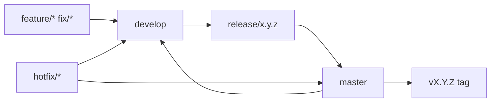

# Workflows

## Branch flow

## CI (pull request)

Workflows under `.github/workflows/` on PRs to `develop` or `master`, and on pushes to `develop` where noted:

| Workflow | Check name | Role |
| --- | --- | --- |
| `ci.yml` | `PHP plugin (8.3/8.4/8.5)` · `MCP server` · `Security (Secrets)` · **`Coverage upload`** | PHP matrix and MCP quality gates (MCP includes `npm audit`); secret scan; final gate needs the three jobs. PRs and pushes to `develop`. |
| `e2e.yml` | Matrix: `Full E2E (PHP 8.3/8.4/8.5)`; required aggregate: **`Docker WordPress + MCP`** | Required aggregate on PRs to `develop` / `master`; it fails unless all PHP matrix jobs pass. Also runs on pushes to `develop`, nightly, and via `workflow_dispatch`. Full Compose E2E and live stack integration. |
| `plugin-e2e.yml` | Matrix: `Plugin REST E2E (PHP 8.3/8.4/8.5)`; required aggregate: **`WordPress plugin REST`** | Required aggregate on PRs to `develop` / `master`; it fails unless all PHP matrix jobs pass. Live plugin REST against Docker WordPress (no MCP). Also runs on `develop` push, nightly, and via `workflow_dispatch`. **Not** in the `Coverage upload` required chain. |
| `commitlint.yml` | `Validate commit messages` | Conventional Commits on every PR commit |
| `semantic-pr.yml` | `Validate PR Title` | PR title type + uppercase subject |
| `scorecard.yml` | Push to `develop`; weekly; manual | OpenSSF Scorecard |

`Coverage upload` is the merge-blocking CI leaf (same pattern as `dto` / `client`). It does not upload Codecov yet; it only succeeds when PHP, MCP (Node 24 audit, lint, tests, and build), and Gitleaks jobs succeed.

## Local commands

| Command | Purpose |
|---------|---------|
| `make ci` | Full quality gate |
| `make test` | Unit tests only |
| `make integration` | Live stack integration (requires `make up` or `make e2e-full`) |
| `make e2e` | Docker WP + plugin + MCP smoke (all 53 tools). Sets `WP_INTERNAL_URL=http://wordpress` and `E2E_SKIP_PUBLIC_URL=0`. |
| `make e2e-full` | Smoke plus content/featured, media verify (including large JPEG), orphan adopt, resources, site-ops, mixed-auth config smoke, and live stack integration. Required on PRs to `develop` / `master`; also nightly and via `workflow_dispatch` in `.github/workflows/e2e.yml`. |
| `make plugin-e2e` | Docker WordPress + plugin only (no MCP). PHPUnit live HTTP against `/wp-json/chatgpt-connector/v1/`. |
| `make plugin-release` | Build `build/wordpress-chatgpt-<version>.zip` (version read from the plugin header) |
| `tools/install-git-hooks` | Install CaptainHook hooks (Docker) |

`make up` keeps `http://localhost:8080` and skips public-URL verify so the host admin UI works. E2E does **not** skip that verify.

## Release (v1.0.0+)

1. Cut `release/x.y.z` from `develop`
2. Update CHANGELOG version section
3. PR to `master`; CI must be green
4. Tag `vx.y.z` on `master`
5. PR merge `master` → `develop`

## Runtime and Docker images

The plugin supports PHP **`^8.3`**. CI and Docker E2E test PHP 8.3, 8.4, and 8.5. Development, tests, and CI use Docker.

| Component / service | Runtime or image | Use |
|---------------------|------------------|-----|
| WordPress plugin tooling (`php`) | `php:8.5.11-cli-bookworm` by default; set `PHP_IMAGE_VERSION` for the PHP 8.3/8.4/8.5 matrix | Composer, lint, and plugin tests |
| WordPress (`wordpress`) | `wordpress:7.1.3-php${WORDPRESS_PHP_VERSION:-8.5}-apache` | Local WordPress host and E2E |
| WordPress CLI (`wp-init`) | `wordpress:cli-2.12.0-php${WORDPRESS_PHP_VERSION:-8.5}` | Local WordPress initialization |
| MCP server (`mcp`) | `node:24.21.0-bookworm-slim` (built from `packages/mcp-server/Dockerfile`) | Local MCP server |
| Node helper (`node`, `integration`) | `node:24.21.0-bookworm-slim`, npm 12.2.0 | CI and integration commands |
| Database (`db`) | `mariadb:12.3.3` | Local WordPress database |

Production MCP-only stack: `docker-compose.prod.yml` + `.env.prod`.
